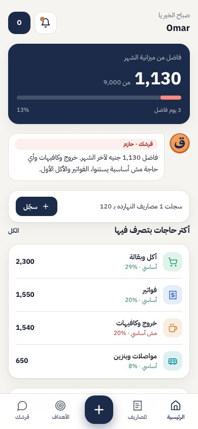
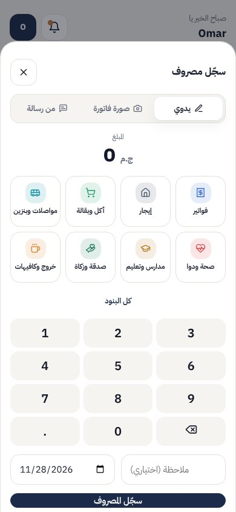
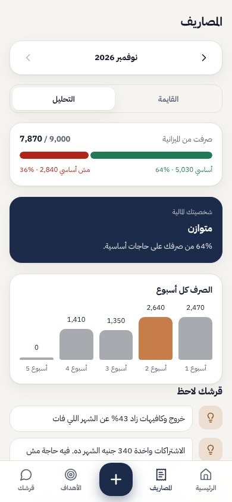
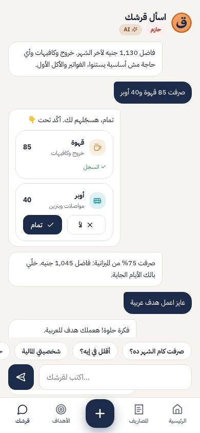
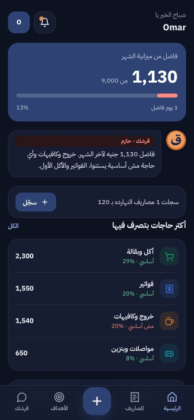
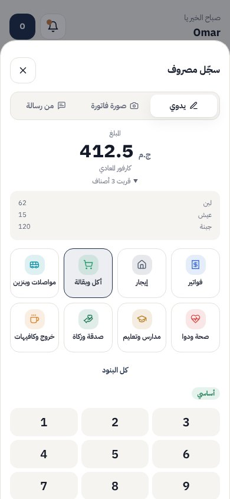
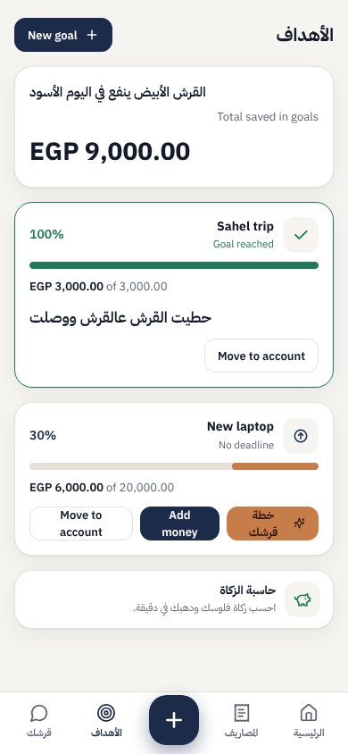
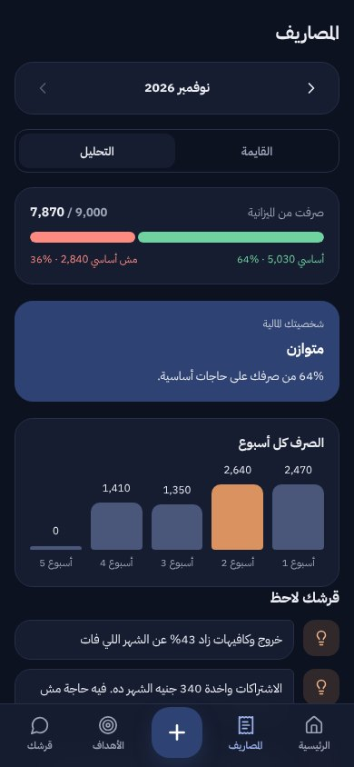
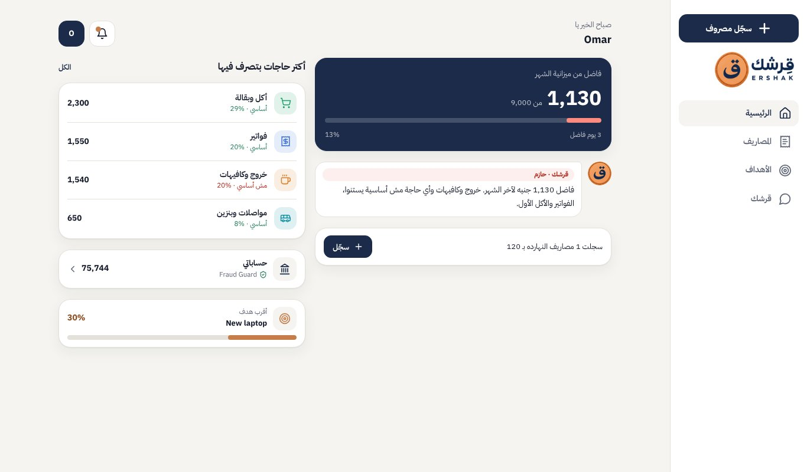

<p align="center">
  
</p>

<h3 align="center">صوت ضميرك في فلوسك</h3>
<p align="center">A personal-finance coach for Egyptian employees and families, with a bank and a Fraud Guard built in.</p>

<p align="center">
  
  
  
  
  
  
</p>

<p align="center"><b>Live:</b> <a href="https://banking-transaction-system-production.up.railway.app">banking-transaction-system-production.up.railway.app</a> · <b>Android:</b> <a href="https://github.com/omarahmedgooda-arch/Banking-Transaction-System/releases/download/android-latest/ershak.apk">ershak.apk</a></p>

<p align="center">
  
  
  
  
</p>

---

## Why Ershak

Most people don't know where their salary goes until it's gone. **Ershak (قِرشك)** is the voice in your head that keeps count:
you log what you spend in seconds, it shows you where the money went and what kind of spender you are, and it tells you,
in Egyptian Arabic, when to slow down. Its mood follows your budget, not the calendar:

| Budget left | Ershak's mood | Sounds like |
|---|---|---|
| more than 60% | **رايق** (playful) | "لسه بدري والدنيا فل. بس الكافيه ده تالت مرة الأسبوع ده يا معلم." |
| 25% – 60% | **هادي** (calm) | "لو قللت الخروج 300 الأسبوع ده، هتقفل الشهر مرتاح." |
| under 25% | **حازم** (firm) | "فاضل 640 جنيه. الهدوم والخروج يستنوا، الفواتير الأول." |

No loans, no interest-bearing accounts, no "buy now, pay later". When you want something, Ershak gives you a saving plan instead.

## Features

### Coach
- **Quick add** in a few seconds: a keypad, your most-used categories first, one-tap repeats ("same as before"), and undo.
- **Three ways to log:** by hand, from a **bank SMS** (Arabic and English formats), or from a **receipt photo** read by AI. Photos are never stored.
- **13 categories** with icons, each marked essential or not, plus your own.
- **Budget alerts** at 75%, 90% and 100%, and when a category is far above your usual.
- **Insights:** essential vs non-essential, spending by week, your **money personality**, things Ershak noticed, and this month vs last.
- **Goal plans:** how much you need per month, how much you're saving now, and which non-essential spending to cut to close the gap.
- **Ask Ershak:** an AI agent that answers from your numbers and proposes actions (log an expense, change the budget, create a goal) that you confirm one by one. It can never move money.
- **Zakat calculator:** nisab from today's gold price, 2.5%.
- **Real push notifications** (Web Push, written on the JDK: VAPID + aes128gcm): a daily "how much did you spend today?" that stays quiet if you already logged something, a weekly summary on the day you pick, budget alerts, and Fraud Guard alerts. Quiet hours are respected, except for security alerts.
- **Installable** on Android, iPhone and desktop (PWA), with an offline app shell and a "log expense" shortcut.

### Bank
- Savings accounts (no interest, 4 outgoing operations a month) and Current accounts (EGP 2,000 overdraft).
- Deposit, withdraw and transfer, with daily limits and an EGP 2 fee to other people. Every transfer is atomic.
- **Fraud Guard** on every outgoing operation, with the reasons shown to the customer.
- OTP confirmation with a simulated SMS inbox, and a **"Not me"** button that cancels a held transfer and freezes the account.
- History with filters and statements as **PDF** (written by hand in Java, no library) or CSV.

### Bank officer console
- Dashboard, review queue for held transfers, customer search, lock/unlock logins, freeze/unfreeze accounts.
- **Tamper-evident audit log:** every entry stores the SHA-256 of the one before it. *Verify integrity* finds any row edited in the database.
- Every fraud threshold and point value can be tuned, and changes are logged.

### Everywhere
Arabic (right-to-left) and English · light, dark or follow the phone · phone, tablet and desktop layouts · accessible contrast and touch targets.

<p align="center">
  
  
  
  
</p>
<p align="center"></p>

## Android app

[Download ershak.apk](https://github.com/omarahmedgooda-arch/Banking-Transaction-System/releases/download/android-latest/ershak.apk), open it on the phone and allow installing from this source.
The app is the same interface (Capacitor), talking to the live server, plus two things only a phone app can do:

- **Bank SMS:** with your permission it reads the SMS inbox (read-only), keeps messages that look like bank transactions,
  and shows them as suggested expenses. Nothing is logged until you tick it, and only those messages leave the phone.
- **Reminders on the phone:** the daily and weekly reminders are scheduled by Android itself.

Every push to `main` that touches `frontend/` rebuilds the APK on GitHub Actions (`.github/workflows/android.yml`) and replaces the `android-latest` release.
To build it yourself: `cd frontend && npm run android`, then open `frontend/android` in Android Studio.
The APK is debug-signed for testing. Google Play only allows SMS reading for default SMS apps, so a store version would rely on pasting or sharing messages instead.

## Run it

You only need **Java 21** ([adoptium.net](https://adoptium.net)).

- **Windows:** double-click `run.bat`
- **macOS / Linux:** `./run.sh`
- **Or:** `java -jar release/ershak.jar`

Then open **http://localhost:7070**. The first start creates `ershak.db` with demo data: three months of expenses, a budget and goals.
To start over, stop the app and delete `ershak.db`.

| Role | Username | Password |
|---|---|---|
| Customer | `omar.ahmed` | `Ershak@2026` |
| Customer | `sara.mahmoud`, `mona.khaled`, `youssef.gomaa` | `Ershak@2026` |
| Customer (team) | `youel`, `mohamed.shaaban`, `mohamed.hany`, `asmaa` | `Ershak@2026` |
| Customer (instructor / testing) | `eng.ahmed`, `test` | `Ershak@2026` |
| Bank officer | `admin` | `Admin@2026` (change it on first login) |
| Bank officer (team) | `youel.admin`, `shaaban.admin`, `hany.admin`, `asmaa.admin`, `ahmed.admin` | `Admin@2026` (change it on first login) |

## Hosting

The web app is inside the jar, so one container serves everything (`Dockerfile`).

**Railway (what the live site uses):** New Project → GitHub Repository → paste the repo URL → Deploy. Then:
1. Right-click the service → **Attach volume** → mount path `/data` (keeps the database between restarts).
2. **Variables:** `ERSHAK_ADMIN_PASSWORD` (a password only you know; without it anyone who reads this README can log in as an officer), plus the AI keys below.
   Officers get this password only when the database is first created; to apply a new one to an existing database, point `ERSHAK_DB` at a new file, such as `jdbc:sqlite:/data/ershak-v2.db`.
3. **Settings → Networking → Generate Domain** (port `8080`). `/api/health` answers `{"status":"ok"}`.
4. New commits deploy automatically only if the Railway GitHub app is installed; otherwise use **Settings → Check for updates**.

`render.yaml` is kept for Render; on its free plan the disk is wiped whenever the service sleeps.

## AI (optional)

The app works without AI: the chat falls back to built-in replies and receipts are typed by hand.
To turn it on, set one or both keys before starting the server. Both are free and need no card.

```bash
GEMINI_API_KEY=...   # https://aistudio.google.com/apikey
GROQ_API_KEY=...     # https://console.groq.com/keys
```

Ershak tries each model in turn until one answers:

| Order | Model | Free requests / day |
|---|---|---|
| 1 | Gemini 3.5 Flash Lite | 500 |
| 2 | Gemini 3.1 Flash Lite | 500 |
| 3 | Gemma 4 31B (same Google key) | 14,400 |
| 4 | Gemma 4 26B (same Google key) | 14,400 |
| 5 | Groq · Qwen 3.8 27B | 1,000 |
| 6+ | any OpenAI-compatible provider you add | — |

```bash
AI_EXTRA_PROVIDERS="zai|https://api.z.ai/api/paas/v4|glm-4.7-flash|ZAI_API_KEY|false"
# name | base URL | model | env var holding the key | reads images; separate several with ;
```

**Privacy and safety.** Prompts carry only totals per category, the budget and goal progress, never notes, merchants, names or account numbers.
The model can only propose actions from a fixed list; the server drops anything else (such as a transfer), checks every amount,
and nothing runs until the customer taps *confirm*. Limits: 40 messages and 15 receipts per customer per day.

## The Fraud Guard

Before money leaves an account, six rules score the risk:

| Rule | Fires when | Points |
|---|---|---|
| R1 | Amount ≥ 5× the customer's 30-day average (needs 3+ past transfers) | 30 |
| R2 | 3 or more outgoing transactions within 2 minutes | 30 |
| R3 | First transfer to an account, amount ≥ EGP 5,000 | 30 |
| R4 | Between 00:00 and 05:00, amount ≥ EGP 2,000 | 20 |
| R5 | Amount ≥ 90% of the account balance | 20 |
| R6 | Amount ≥ 80% of what is left of today's limit | 10 |

| Score | What happens |
|---|---|
| 0 – 29 | Goes through |
| 30 – 59 | The customer confirms with a one-time code |
| 60+ | Held until a bank officer approves or rejects it |

Each rule is one class implementing `FraudRule` (Strategy pattern), so a new rule is one new class.

## Architecture

```
frontend/  React 18 + Vite  ──HTTP/JSON──►  backend/  Java 21
                                              ├── web/        tiny HTTP server + JSON (JDK only, no framework)
                                              ├── api/        REST routes, one call into the core each
                                              ├── coach/      expenses, budgets, insights, mood, SMS parser, AI
                                              ├── service/    accounts, transfers, goals, admin, audit
                                              ├── fraud/      FraudEngine + 6 rules
                                              ├── model/      Account → SavingsAccount / CurrentAccount, Transaction, …
                                              ├── dao/        JDBC + prepared statements
                                              ├── security/   PBKDF2, sessions, rate limiting
                                              ├── exception/  InsufficientFunds, InvalidAmount, AccountFrozen, …
                                              └── db/         SQLite, ACID transactions
```

- **Pure Java.** The server, routing, JSON, PDF writer and AI clients sit on the JDK. The only library is the SQLite JDBC driver.
- **OOP:** inheritance and polymorphism (`Account`), Factory (`AccountFactory`), Strategy (`FraudRule`), Singleton (`Database`), a custom exception hierarchy (`BankException`).
- **Money** is always `BigDecimal` with 2 decimals, never `double`.
- **Security:** PBKDF2 hashing, random session tokens with a 5-minute idle timeout, login rate limiting and lockout, prepared statements, ownership checks on every record, strict security headers.

## Develop

Requirements: Java 21, Maven, Node 18+.

```bash
# Backend: tests and runnable JAR
cd backend
mvn test
mvn package            # → backend/target/ershak.jar
mvn exec:java          # http://localhost:7070

# Frontend with live reload (proxies /api to :7070)
cd frontend
npm install
npm run dev            # http://localhost:5173
npm run build          # builds the web app into the Java project
```

| Variable | Default | |
|---|---|---|
| `PORT` | `7070` | If busy and not set, the next free port is used |
| `ERSHAK_DB` | `jdbc:sqlite:ershak.db` | Database file |
| `ERSHAK_DEMO_DATA` | `true` | Create demo customers on first start |
| `ERSHAK_ADMIN_PASSWORD` | `Admin@2026` | Starting password for every officer |
| `ERSHAK_ALLOWED_ORIGIN` | — | Frontend URL when hosted separately |
| `GEMINI_API_KEY`, `GROQ_API_KEY`, `AI_EXTRA_PROVIDERS` | — | AI, see above |

## Testing

- `backend/src/test`: 47 JUnit tests: accounts, every fraud rule, OTP, holds, lockout, ownership, audit tampering, goals, JSON, the PDF statement, idle sessions, the SMS parser, category guessing, moods and the coach.
- `docs/Ershak.postman_collection.json`: API requests with assertions. Import into Postman, run the app, run the collection.

## Demo script (5 minutes)

1. Log in as `omar.ahmed`. Ershak is **firm**: most of the budget is gone. Open **Insights**: personality, weekly bars, what Ershak noticed.
2. Tap **+**, log a coffee in three taps, then undo it. Paste a bank SMS in the *Bank SMS* tab.
3. Open **Ask Ershak**: "صرفت 85 قهوة و40 أوبر" → two confirm cards. Then "حوّل 500 لأحمد" → it refuses.
4. **Goals → Ershak's plan** on *New laptop*: what to cut and by how much.
5. **My accounts:** transfer EGP 3,000 from the current account → OTP with the reasons. Transfer EGP 9,500 from savings to a new person → **held**.
6. Log in as `admin` in another browser and reject it. Omar gets the money back.
7. Edit any row of `audit_log` in DB Browser for SQLite, then press **Verify integrity** → tampering detected.

## API

All endpoints are under `/api`. Send `Authorization: Bearer <token>` after logging in.

| Method | Path | |
|---|---|---|
| POST | `/auth/register`, `/auth/login`, `/auth/logout` | Sessions |
| GET · POST | `/me` · `/me/password` | Current user |
| GET, POST | `/accounts` · POST `/accounts/{id}/close` | Accounts |
| GET | `/accounts/{id}/transactions?type&status&from&to&min&max&page&size` | History |
| GET | `/accounts/{id}/statement.csv` · `/statement.pdf` | Statements |
| POST | `/transactions/deposit`, `/withdraw`, `/transfer` | Money (returns the risk) |
| POST | `/transactions/{id}/otp`, `/transactions/{id}/cancel` | OTP and "Not me" |
| GET | `/transactions/recent`, `/transactions/{id}` | Activity |
| GET, POST, DELETE | `/goals`, `/goals/{id}/contribute`, `/goals/{id}/withdraw` | Savings goals |
| GET · POST | `/notifications`, `/sms` · `/notifications/read-all` | Inbox |
| GET, POST, DELETE | `/coach/categories`, `/coach/categories/{id}` | Categories |
| GET, POST, PUT, DELETE | `/coach/expenses?month`, `/coach/expenses/{id}` | Expenses |
| PUT · GET | `/coach/budget` · `/coach/overview?month`, `/coach/insights?month` | Budget, mood, insights |
| GET | `/coach/goals/{id}/plan` | Goal plan |
| POST | `/coach/sms` | Read a bank SMS |
| GET · POST | `/coach/ai` · `/coach/chat`, `/coach/receipt` | AI status, agent, receipts |
| GET, PUT · POST | `/push/key`, `/push/prefs` · `/push/subscribe`, `/push/unsubscribe`, `/push/test` | Push notifications and reminders |
| GET | `/admin/overview`, `/admin/reviews`, `/admin/customers`, `/admin/audit`, `/admin/rules` | Officer |
| POST | `/admin/reviews/{id}/approve` · `/reject`, `/admin/users/{id}/lock` · `/unlock`, `/admin/accounts/{id}/freeze` · `/unfreeze`, `/admin/audit/verify` | Officer actions |
| PUT | `/admin/settings` | Tune rules and limits |

## Team

**Status 404** · DEPI (Digital Egypt Pioneers Initiative), Software Testing track.

## License

[MIT](LICENSE) © 2026 Omar Ahmed and the Ershak team.

<sub>Ershak is an educational project. No real money, cards, SMS or bank connections.</sub>
